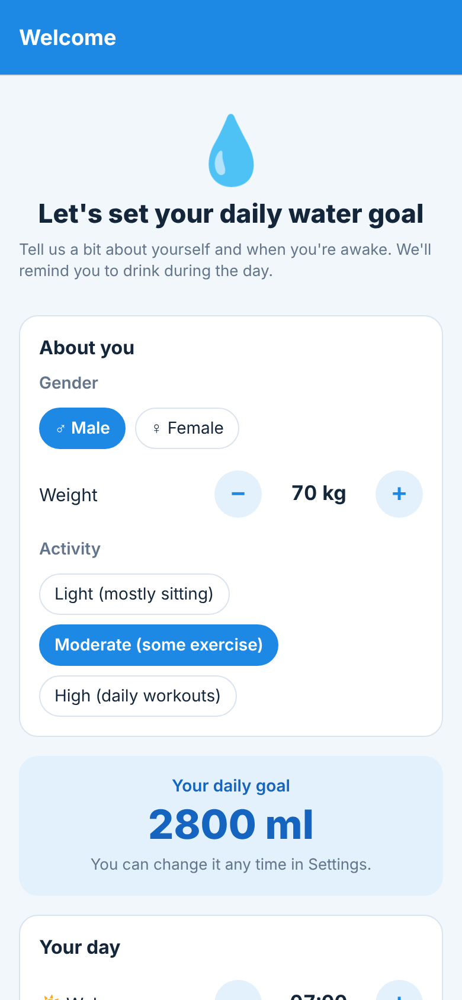
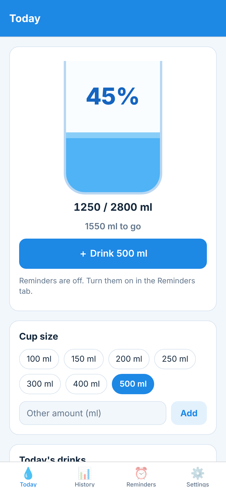
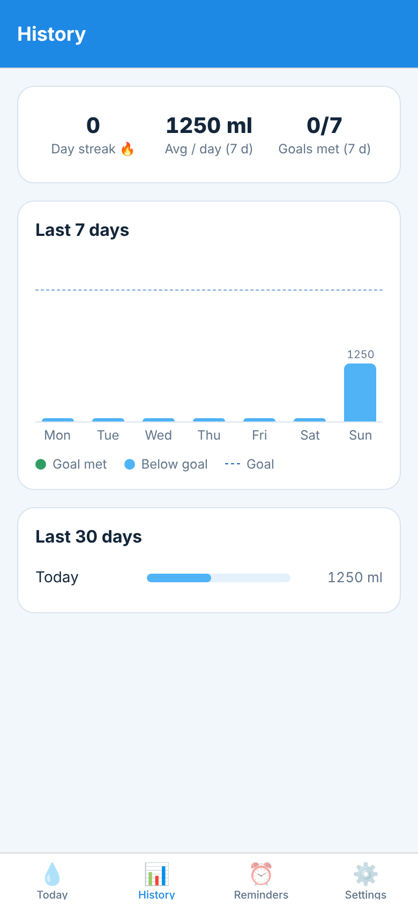
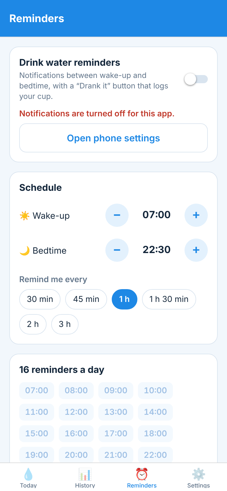

# Water Reminder 💧

A drink-water reminder and tracker for Android. Set a daily goal, log each glass with one tap, and get reminders
through the day. Everything is stored **on your phone** (SQLite). There is no account and no internet needed.

| Setup | Today | History | Reminders |
|---|---|---|---|
|  |  |  |  |

## Features
- **First-launch setup:** gender, weight and activity give a recommended daily goal (weight × 35 ml for men or 31 ml
  for women, plus 350–700 ml for exercise). Set your wake-up time, bedtime and how often to be reminded.
- **Today:** a glass that fills up as you drink, a big “Drink” button, cup sizes from 100 to 500 ml or any custom
  amount, today's log (tap ✕ to remove a drink), and the time of the next reminder.
- **Reminders:** a notification every 30 min to 3 h between wake-up and bedtime. Each one has a **“Drank 250 ml ✓”**
  button that logs your cup without you having to open the app. Reminders keep working after a phone restart.
  Includes a test button.
- **History:** day streak, 7-day average, goals met, a 7-day bar chart with the goal line, and the last 30 days.
- **Settings:** adjust the goal, update your profile, switch between ml and US fl oz, delete all data.

## Get the APK
1. On GitHub, open **Actions** and then the latest successful **Build Water Reminder APK** run.
2. Download the **water-reminder-apk** artifact (a zip) and unzip it to get `water-reminder.apk`.
3. Copy the APK to your phone and open it. The first time, Android asks you to allow installs from that app.

> The APK is signed with the default debug key, which is fine for installing it yourself. To publish on the Play Store
> you need a real release keystore (or EAS Build).

If reminders arrive late, turn off battery optimisation for the app in Android settings. Some phone brands delay
notifications from apps they put to sleep.

## Develop
```bash
cd water-reminder
npm install
npm test            # unit tests for goal, reminder times, units and stats
npm run typecheck
npm run android     # build and run on a device or emulator (needs the Android SDK)
```
Notifications need a development build or the APK; they do not work in Expo Go or on the web.

## Code layout
```
src/app/            screens (Expo Router): onboarding, (tabs)/index (Today), history, reminders, settings
src/hooks/          AppState: settings, today's drinks, and the notification "Drank it" button
src/db/             SQLite schema, drinks and settings storage
src/lib/            goal and reminder maths, stats, time helpers (pure TypeScript, unit-tested), notifications
src/components/     water glass, week chart, forms and UI building blocks
```
